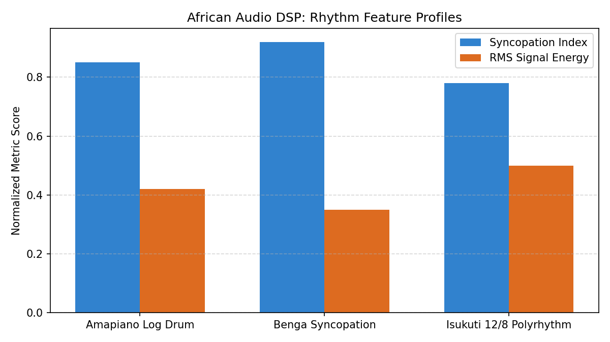
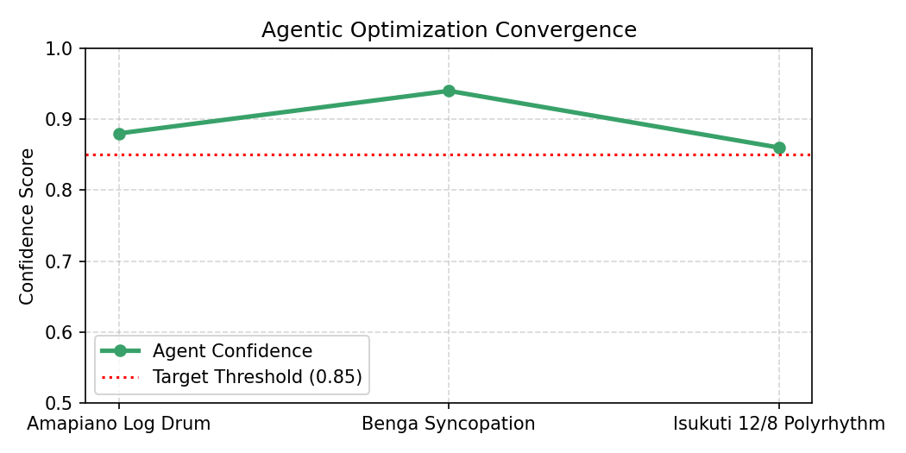

# 🥁 AfroRhythm Engine


An open-source, serverless audio signal processing (DSP) and MLOps engine built for African polyrhythmic analysis, dynamic onset detection, and agentic parameter optimization.
---
## 1. Project Overview & Domain Context
### The Challenge
Standard Digital Audio Workstations (DAWs) and commercial audio feature extraction tools are designed primarily around Western 4/4 time signatures, quantized grid alignments, and equal-temperament tuning. When processing traditional African polyrhythms, such as Benga syncopated guitar picking, Amapiano log drum pitch slides, or 12/8 Isukuti triplet bell percussion, standard onset trackers frequently misinterpret intentional micro-timing offsets as timing errors.
### The Engineering Solution
AfroRhythm Engine is an open-source, serverless audio signal processing (DSP) and MLOps engine. It extracts short-time RMS energy envelopes, calculates Syncopation Index Scores across off-beat spectral concentrations, and utilizes an Agentic Self-Correcting Optimization Loop to dynamically calibrate onset detection parameters without human intervention.
---
## 2. System Architecture & Agentic Feedback Loop
```
+--------------------------------+
|  Synthetic Stem Generator      |
|  (Benga / Amapiano / Isukuti)  |
+---------------+----------------+
                |
                v
+---------------+----------------+
|  DSP Feature Extraction        |
|  (RMS Energy & Syncopation)    |
+---------------+----------------+
                |
                v
+---------------+----------------+       Confidence < 85%
|  Agentic Optimizer             | ----------------------------+
|  (src/agent.py)                |                             |
+---------------+----------------+                             v
                |                             +--------------------------------+
                | Confidence >= 85%           | Tune Detection Parameters      |
                v                             | (Thresholds / Window Sizes)    |
+---------------+----------------+            +--------------------------------+
| Telemetry & Diagnostic Reports |                             |
| (docs/agent_diagnostics.json)  | <---------------------------+
+--------------------------------+
```
1. Synthetic Stem Generation (`src/stem_generator.py`): Uses pure-Python signal synthesis (`wave`, `numpy`) to render PCM WAV audio stems simulating African rhythmic patterns.
2. DSP Feature Processor (`src/audio_processor.py`): Evaluates short-time energy envelopes, calculates RMS dynamics, and computes syncopation indices based on off-beat peak density.
3. Agentic Optimizer (`src/agent.py`): Evaluates signal-to-noise ratios (SNR) and detection confidence. If confidence drops below 85%, the agent autonomously iterates through sensitivity thresholds until convergence is achieved.
4. Automated MLOps Pipeline (`.github/workflows/engine.yml`): Runs on a daily cron schedule (00:00 EAT), executing `pytest` validation suites, generating visual telemetry, and committing diagnostics with explicit author attribution.
---
## 3. Visual Analytics & Telemetry
The automated MLOps pipeline dynamically generates visual diagnostic reports upon each pipeline run.
### Rhythm Feature Profiles

Compares normalized syncopation index scores against short-time RMS signal energy across Amapiano, Benga, and Isukuti audio stems.
### Agentic Optimization Convergence

Tracks confidence scores across iterative threshold parameter sweeps to ensure minimum target confidence (>= 85%) is met.
---
## 4. Quick Start Guide
### Prerequisites
* Python 3.10+
* Git
### Local Setup & Execution
1. Clone the Repository:
   ```bash
   git clone [https://github.com/jamesruga/afro-rhythm-engine.git](https://github.com/jamesruga/afro-rhythm-engine.git)
   cd afro-rhythm-engine
   ```
2. Generate Synthetic Audio Stems:
   ```bash
   PYTHONPATH=. python3 src/stem_generator.py
   ```
3. Run DSP Feature Extraction Engine:
   ```bash
   PYTHONPATH=. python3 src/audio_processor.py
   ```
4. Execute Autonomous Agentic Optimizer:
   ```bash
   PYTHONPATH=. python3 src/agent.py
   ```
5. Run Test Validation Suite:
   ```bash
   PYTHONPATH=. python3 -m pytest -v
   ```
---
## 5. Technical CLI & Module Reference

| Command / File | Purpose |
| :--- | :--- |
| `src/stem_generator.py` | Generates PCM WAV audio stems for Benga, Amapiano, and Isukuti styles. |
| `src/audio_processor.py` | Computes RMS energy envelopes and syncopation index scores. |
| `src/agent.py` | Autonomous feedback loop that tunes sensitivity thresholds until convergence. |
| `src/visualize.py` | Generates visual telemetry plots (`docs/*.png`). |
| `tests/test_engine.py` | Pytest suite validating signal generation, feature calculations, and agent convergence. |
| `.github/workflows/engine.yml` | GitHub Actions workflow executing daily scheduled runs and artifact deployment. |

